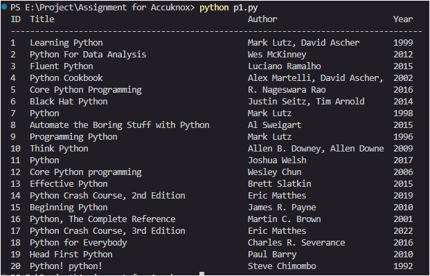

# Assignment for Accuknox

## Table of Contents
- [Overview](#overview)
- [Assignments](#assignments)
- [Projects](#projects)
- [Setup & Run](#setup--run)
- [Screenshots](#screenshots)

---

## Overview

This repository contains Python scripts developed as part of the Accuknox assignment. The projects demonstrate data retrieval from APIs, database operations, data visualization, and CSV processing using Python.

---

## Assignments

### Assignment 1: API Data Retrieval and Storage
Three Python scripts that handle different data processing tasks.

| Script | Description | File |
|--------|-------------|------|
| `p1.py` | Fetch books from OpenLibrary API and store in SQLite database | [p1.py](p1.py) |
| `p2.py` | Fetch student scores from API, calculate average, create bar chart | [p2.py](p2.py) |
| `p3.py` | Import users from CSV file to SQLite database | [p3.py](p3.py) |

---

## Projects

### Project 1: Book Database (`p1.py`)
Fetches Python-related books from OpenLibrary API and stores them in SQLite.

**Features:**
- REST API integration
- SQLite database operations
- Data deduplication
- Formatted console output

### Project 2: Student Scores Visualization (`p2.py`)
Fetches student scores, calculates average, and generates a bar chart.

**Features:**
- API data fetching with fallback
- Mathematical calculations
- Data visualization using matplotlib
- Image export functionality

### Project 3: CSV to Database Import (`p3.py`)
Imports user data from CSV file to SQLite database.

**Features:**
- CSV file parsing
- Data validation
- Database insertion with duplicate handling
- Feedback on inserted/skipped records

---

## Setup & Run

### Prerequisites
- Python 3.8+
- pip package manager

### Installation

```bash
# Install dependencies
pip install requests matplotlib sqlite3
```

### Running the Scripts

```bash
# Script 1: Books from API to SQLite
python p1.py

# Script 2: Student scores with visualization
python p2.py

# Script 3: CSV to Database
python p3.py
```

### Database Files
- `books.db` - Contains book data from Script 1
- `users.db` - Contains user data from Script 3

### Output Files
- `scores_chart.png` - Bar chart generated by Script 2

---

## Screenshots

### Script 1 Output (p1.py - Books Database)


**Description:** Displays fetched books with ID, Title, Author, and Publication Year.

---

### Script 2 Output (p2.py - Student Scores)


**Description:** Shows average score (80.00) and bar chart visualization of student scores.

---

### Script 3 Output (p3.py - CSV Import)


**Description:** Shows 5 users inserted successfully with their name and email data.

---

## Tech Stack
- **Python** - Core programming language
- **SQLite3** - Lightweight database
- **Requests** - HTTP library for API calls
- **Matplotlib** - Data visualization
