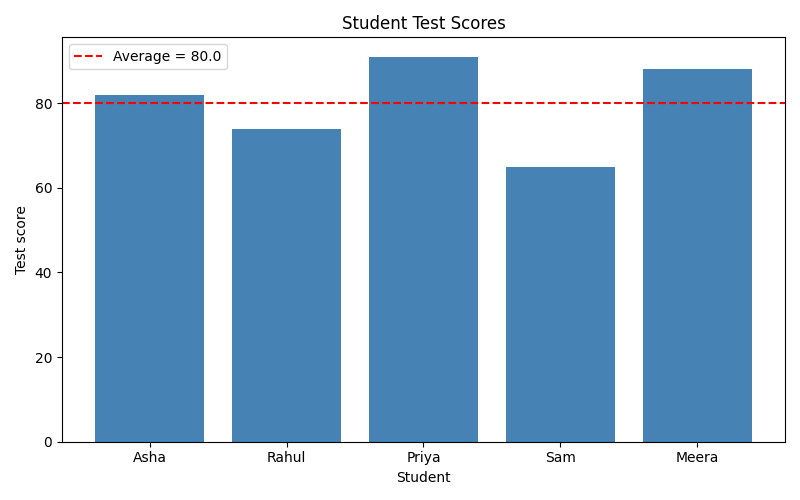

# Assignment 1 - Accuknox

Python scripts for API data retrieval, database operations, and data visualization.

---

## Files

| File | Description |
|------|-------------|
| `p1.py` | Fetches books from API → Stores in SQLite |
| `p2.py` | Fetches student scores → Calculates average → Creates bar chart |
| `p3.py` | Reads CSV → Imports into SQLite database |

---

## Setup

### Install Dependencies
```bash
pip install requests matplotlib
```

### Run Scripts
```bash
python p1.py
python p2.py
python p3.py
```

---

## Screenshots

### Output 1: Books Database (p1.py)


---

### Output 2: Student Scores Visualization (p2.py)

**Average Score Output:**


**Bar Chart Generated:**


---

### Output 3: CSV Import (p3.py)


---

## How It Works

### p1.py - Book API → SQLite
- Fetches books from OpenLibrary API
- Stores in `books.db` SQLite database
- Displays formatted table in console

### p2.py - Student Scores → Bar Chart
- Fetches student scores from API
- Calculates average score
- Creates bar chart using matplotlib
- Saves chart as `scores_chart.png`

### p3.py - CSV → SQLite
- Reads `users.csv` file
- Validates data (name, email format)
- Inserts into `users.db` SQLite database
- Reports inserted/skipped records
